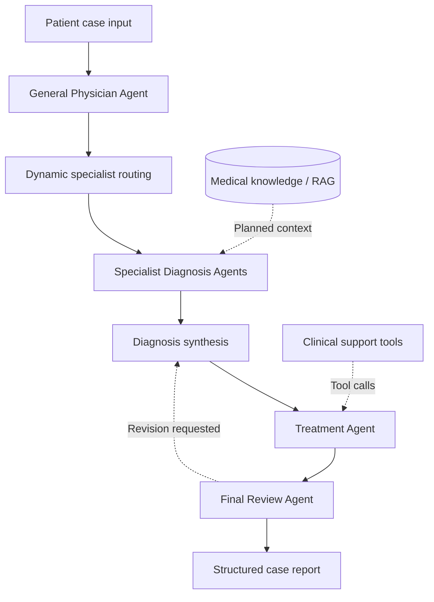

# MedCouncil

**A multi-agent medical decision-support prototype built with LangGraph and LangChain.**

MedCouncil explores how an LLM-based team of medical agents can collaborate on a synthetic patient case: an initial general assessment, specialist-oriented differential diagnosis, a proposed treatment plan, and a final safety review.

> [!IMPORTANT]
> **Research and educational use only.** MedCouncil is an experimental software project, not a medical device or a clinical decision-making tool. It must not be used to diagnose, treat, or manage real patients. Model outputs may be inaccurate, incomplete, or unsafe and require qualified human review.

## Overview

Rather than relying on one LLM response, MedCouncil separates the workflow into focused agent responsibilities. The project aims to support dynamic specialist selection, structured data exchange, medical knowledge retrieval, tool use, and cross-agent review.

### Intended workflow



*This diagram shows the **target V1 architecture**, not a claim that every node and integration is complete.*

## Core components

| Component | Responsibility | Status |
| --- | --- | --- |
| General Physician Agent | Assess the initial case and identify relevant specialties | Initial implementation |
| Specialist Diagnosis Agents | Evaluate possible conditions from specialist perspectives | Initial implementation |
| Diagnosis Synthesis | Consolidate diagnostic reasoning, differentials, and suggested tests | Initial implementation |
| Patient schemas (Pydantic) | Define structured patient and agent data | Initial implementation |
| Treatment Agent | Propose and check treatment recommendations using tools | In development / debugging |
| Final Review Agent | Check consistency, missing information, and safety concerns | Planned / integration to verify |
| LangGraph workflow | Coordinate routing, state, and review loops | Integration in progress |
| RAG | Ground responses in curated medical reference material | Planned |
| Observability / HITL / MCP | Improve tracing, human oversight, and tool connectivity | Optional future enhancements |

*Statuses describe the project at the time of this README draft and should be updated as implementation progresses.*

## Technology stack

- **Python 3.11**
- **LangChain** — LLM and tool interfaces
- **LangGraph** — multi-agent workflow orchestration
- **Pydantic** — structured schemas and validation
- **LLM provider integration** — configured locally through environment variables

Additional dependencies may be added as features are implemented.

## Project structure

The project is organized around the following modules (exact file names may differ):

```text
MedCouncil/
├── src/
│   ├── agents/       # General physician, specialist, treatment, review
│   ├── graph/        # Workflow orchestration and shared state
│   ├── schemas/      # Patient and agent output models
│   ├── tools/        # Supporting tool interfaces
│   ├── rag/          # Retrieval components (planned)
│   ├── services/     # Application services
│   └── api/          # API layer (as implemented)
├── tests/            # Synthetic test cases
├── .env.example      # Environment variable names, no secrets
└── README.md
```

## Getting started

### 1. Clone the repository

```bash
git clone https://github.com/<YOUR_USERNAME>/MedCouncil.git
cd MedCouncil
```

### 2. Create a Python environment

```bash
conda create -n medcouncil python=3.11
conda activate medcouncil
```

### 3. Install dependencies

Once a dependency manifest has been committed, install it using the matching command:

```bash
pip install -r requirements.txt
```

### 4. Configure credentials

Create a local `.env` file based on `.env.example` (if provided), then set the API keys required by your chosen LLM provider. **Never commit `.env` or real API keys.**

### 5. Run the project

The entry point and test commands will be documented after the end-to-end workflow is finalized. Until then, refer to the scripts and tests included in the repository.

## Development roadmap

- [x] Establish initial agent and module structure
- [x] Implement initial general physician and specialist diagnosis logic
- [x] Define structured patient schemas and diagnosis outputs
- [ ] Stabilize Treatment Agent tool calls and error handling
- [ ] Complete Final Review Agent and end-to-end LangGraph integration
- [ ] Add tests for agent routing, structured outputs, and failure cases
- [ ] Integrate curated medical knowledge retrieval (RAG)
- [ ] Document reproducible setup and demo execution
- [ ] Explore tracing, human-in-the-loop review, and MCP where useful

## Safety and limitations

- Only **synthetic or appropriately de-identified** cases should be used in development; never include private patient records or protected health information in the repository.
- Generated diagnoses, medication suggestions, and drug-interaction assessments are **not verified clinical guidance**.
- A multi-agent design does not guarantee accuracy or eliminate hallucinations.
- Production clinical use would require robust validation, governance, security, regulatory review, and clinical oversight beyond the scope of this project.

## Project goals

This project is a portfolio and learning exercise in:

- Multi-agent orchestration and dynamic routing
- Agent-as-Tool patterns and tool calling
- Structured state and schema validation
- Retrieval-augmented generation
- Automated review loops and error handling

## License

No license has been selected yet. Add a `LICENSE` file before specifying reuse permissions.
